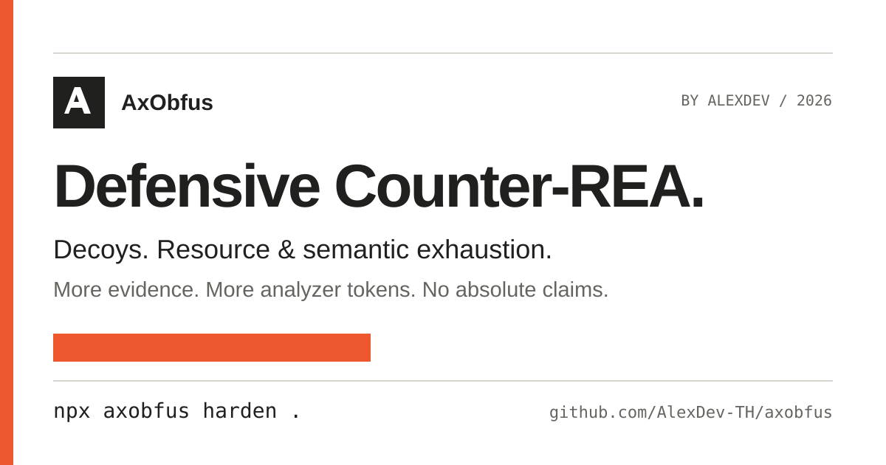

<div align="center">
  

  # AxObfus

  **ชุดเครื่องมือ Counter-REA สำหรับปกป้องผลงานของคุณ**
  พัฒนาโดย **AlexDev** · แพ็กเกจและ CLI: `axobfus`

  [เริ่มต้นใช้งาน](docs/installation.md) · [CLI และ MCP](docs/cli-and-mcp.md) · [ข้อจำกัดความรับผิด](DISCLAIMER.md) · [MIT License](LICENSE)

  [](https://www.npmjs.com/package/axobfus)
  [](DISCLAIMER.md)
  [](LICENSE)
</div>

AxObfus เป็น CLI และ MCP server แบบโอเพนซอร์สสำหรับ **ปกป้อง artifact ที่คุณเป็นเจ้าของหรือได้รับอนุญาต** จากการวิเคราะห์ย้อนกลับอัตโนมัติด้วย AI (Reverse-Engineering Agents: REA) เครื่องมือนี้เพิ่ม decoy ที่ถูกต้องตามรูปแบบไฟล์ เพิ่มภาระด้านทรัพยากรและความหมาย และทำให้ analyzer ต้องใช้โทเคนมากขึ้น จึงยากต่อการสรุปหรือ reconstruct ตรรกะที่แท้จริง

> **ไม่ใช่การป้องกันแบบสมบูรณ์:** AxObfus เพิ่มต้นทุนและความกำกวมให้การวิเคราะห์ แต่ไม่รับประกันความลับจากนักวิเคราะห์ที่มีเวลา เครื่องมือ หรือสิทธิ์เข้าถึง runtime อย่างไม่จำกัด ควรเก็บความลับสำคัญไว้ฝั่งเซิร์ฟเวอร์และใช้ร่วมกับการป้องกันชั้นอื่น



## เริ่มต้นในไม่กี่คำสั่ง

ต้องใช้ Node.js `^22.23.4 || >=24.0.0` ใช้จากซอร์สได้ทันที:

```bash
git clone https://github.com/AlexDev-TH/axobfus.git
cd axobfus
npm ci
npm run build

# ลงทะเบียน MCP และทักษะให้ coding agent ที่รองรับ
node dist/cli.js setup

# ค้นหา build output และทำขั้นตอนป้องกันอัตโนมัติ
node dist/cli.js harden .
```

เมื่อเผยแพร่แพ็กเกจบน npm แล้ว จะเรียกสั้น ๆ ด้วย `npx axobfus setup` และ `npx axobfus harden .` ได้

หรือแยกแต่ละขั้นตอนเพื่อควบคุมและเก็บหลักฐานด้วยตนเอง:

```bash
# ตรวจ exposure และบันทึกรายงาน HTML
axobfus audit ./dist --report ./reports/audit.html

# ป้องกัน target ที่ระบุ พร้อมรายงานผลการทำงาน
axobfus defend ./dist --report ./reports/defend.html

# ตรวจสอบ artifact ที่ป้องกันแล้วเทียบกับต้นฉบับ
axobfus verify ./dist.protected ./dist
```

`--report` สำหรับ `audit` และ `defend` สร้างรายงาน HTML แบบ standalone เปิดอ่านออฟไลน์ได้โดยไม่มีสคริปต์หรือทรัพยากรภายนอก เหมาะสำหรับตรวจทานและจัดเก็บเป็น CI artifact โดยไม่ควรตีความค่าประมาณโทเคนเป็นผลทดลองกับ analyzer ทุกตัว

## กลไกป้องกัน

- **Decoys และหลักฐานลวง:** เพิ่ม metadata, control flow และเส้นทาง semantic ที่ดูสมเหตุสมผล เพื่อลดความน่าเชื่อถือของการอนุมานอัตโนมัติ
- **Resource exhaustion:** เพิ่มงานด้าน header, nesting, interface และ call graph ให้เข้าใกล้หรือเกินงบประมาณของ analyzer ที่รองรับ
- **Semantic exhaustion และ token consumption:** เพิ่มจำนวนหลักฐานที่ต้องพิจารณา ทำให้การวิเคราะห์ใช้ขั้นตอนและโทเคนมากขึ้น
- **Audit และ verification:** ตรวจ exposure ก่อนเปลี่ยนแปลง และตรวจ invariants รวมถึงความเท่าเทียมของ runtime ตาม workload ที่กำหนดหลังป้องกัน

รองรับกลุ่ม artifact เช่น JavaScript/TypeScript, Electron/ASAR, WebAssembly, Python, SQLite, native binaries, model formats และ mobile formats โดยกลไกจริงขึ้นกับรูปแบบไฟล์ ดูรายละเอียดคำสั่งใน [CLI และ MCP](docs/cli-and-mcp.md)

## ผลทดสอบกับ REA จริง

AxObfus `0.1.0` ผ่าน empirical red-team กับ REA `6.8.0` บน Node `24.22.1` แล้ว โดย **11 รูปแบบ**ชน resource budget หรือข้อจำกัดที่คาดไว้ ได้แก่ Go buildinfo, Flutter pool, BEAM, EVM, Safetensors, GGUF, ASAR, WASM, SQLite, Electron fuses และ JavaScript ผล PCAP ยังไม่ยืนยันเพราะไม่มี `tshark` ส่วน PTX ไม่ได้ชน budget ในรอบนี้

อ่านรายงานดิบและเกณฑ์เปรียบเทียบใน [Empirical REA validation](docs/redteam/empirical-rea-validation.md) หรือทำซ้ำด้วย `npm run redteam:rea` เมื่อมี REA checkout ที่ `../rea` หรือกำหนด `REA_ROOT` ตัวเลข token/cost ในส่วนอื่นยังเป็น internal estimates ไม่ใช่ปริมาณโทเคนที่วัดจาก REA โดยตรง

## วงจรใช้งานที่แนะนำ

1. สำรอง artifact ต้นฉบับและกำหนด workload สำหรับทดสอบ
2. รัน `audit` แล้วเก็บ `--report` เพื่อประเมิน exposure
3. รัน `harden` หรือ `defend` บนสำเนาใน staging
4. รัน `verify` และชุดทดสอบของผลิตภัณฑ์ก่อนเผยแพร่
5. เก็บรายงานเป็นหลักฐานประกอบ release โดยไม่เปิดเผยข้อมูลลับในรายงานสาธารณะ

## เอกสารและการทดสอบ

- [การติดตั้งและตั้งค่า agent](docs/installation.md)
- [CLI, รายงาน และ MCP](docs/cli-and-mcp.md)
- [ข้อจำกัดด้านการใช้งานและเทคนิค](DISCLAIMER.md)

สำหรับผู้ดูแลโค้ด คำสั่งต่อไปนี้เป็น **แนวทางตรวจสอบก่อน release ไม่ใช่การอ้างว่าชุดทดสอบถูกรันแล้วในเอกสารฉบับนี้**:

```bash
npm run build
npm test
```

ผลลัพธ์ต้องตรวจสอบในสภาพแวดล้อมและ artifact ของคุณเอง หน้าเว็บไม่นำตัวเลข benchmark ของโครงการต้นทางมาแสดงเป็นผลลัพธ์ของ AxObfus

## เครดิตและสัญญาอนุญาต

AxObfus โดย AlexDev พัฒนาต่อจาก **BLA (Blind LLM Agents)** ต้นฉบับที่ [https://github.com/qybaihe/bla](https://github.com/qybaihe/bla) ซึ่งเผยแพร่ภายใต้ MIT License โครงการนี้คงการระบุที่มาของต้นฉบับและเงื่อนไข MIT ไว้ ดู [LICENSE](LICENSE) และ [DISCLAIMER.md](DISCLAIMER.md)

ซอร์สโค้ดและการมีส่วนร่วม: [AlexDev-TH/axobfus](https://github.com/AlexDev-TH/axobfus)
